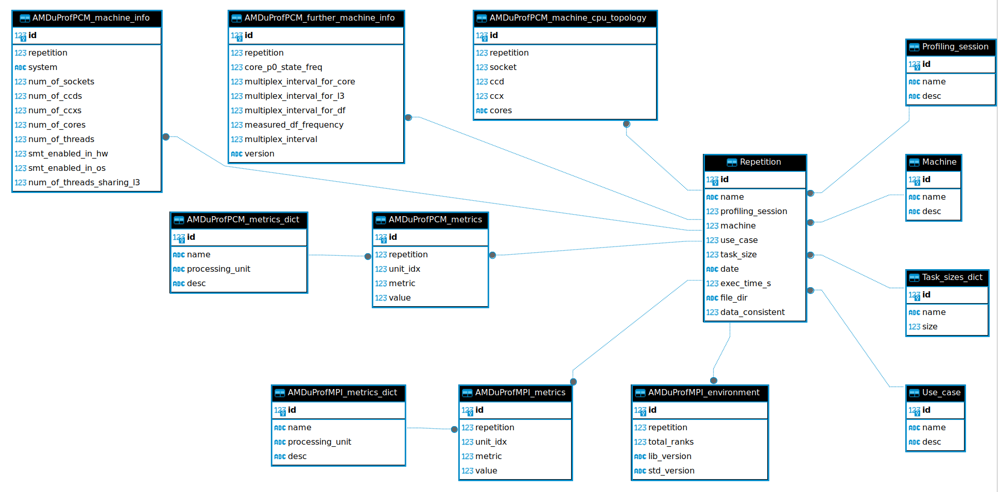

# Quare

**QUality AnalyzeR of application Efficiency**

> **Development status:** Quare is actively under development. The API,
> configuration format, and extension interface may change between releases.
> Contributions and feedback are welcome.

## Why Quare?

Modern HPC applications are hard to optimise. Profiling tools such as AMD uProf
generate large volumes of raw counter data, but turning that data into
actionable insight requires a repeatable, automated pipeline: ingest the raw
output, normalise it, store it in a structured form, and produce consistent
visualisations across runs, machines, and problem sizes.

Without such a pipeline, performance analysis becomes ad-hoc — scattered
spreadsheets, one-off scripts, and results that are difficult to reproduce or
compare. Quare solves this by providing a unified ETL and analytics framework
tailored to HPC workloads.

The name is deliberate. In Latin, *quare* means "therefore", "because of this",
"why" — which is exactly what the tool is designed to tell you: *why* does this
application perform the way it does on this hardware?

### Current scope

Quare currently focuses on **OpenFOAM**-based workloads as its primary
application target. OpenFOAM is a widely-used open-source CFD (Computational
Fluid Dynamics) framework, and the existing extensions, analyses, and example
configurations are oriented towards profiling OpenFOAM solvers at scale.
Support for other HPC application frameworks is planned for future releases.

Quare is a Python framework for ingesting, storing, and visualising
performance-profiling data from HPC applications.

## Supported profilers

| Extension | Profiler | Status |
|---|---|---|
| `AMDuProfPCM_ext` | AMD uProf Performance Counter Monitor | Stable |
| `AMDuProfMPI_ext` | AMD uProf MPI profiler | Stable |
| `OpenFOAMlogs_ext` | OpenFOAM solver logs | Work in progress |

## Database schema



## Prerequisites

- Python 3.10 or later
- [Poetry](https://python-poetry.org/) for dependency management
- `graphviz` system package (only needed for documentation generation)

## Installation

```bash
git clone https://github.com/HiPERACT-Data-analytics-and-AI/Quare.git
cd Quare
poetry install
```

The `quare` command is then available inside the Poetry environment:

```bash
poetry run quare --help
```

## Configuration

Quare is driven by a JSON settings file. Copy the bundled example and edit it
to match your data layout:

```bash
cp quare/settings.json my_settings.json
```

Key fields:

| Field | Description |
|---|---|
| `raw_data_directory_path` | Root of the raw profiler output tree |
| `preprocessed_data_directory_path` | Where preprocessed CSVs are written |
| `db_path` | Path to the SQLite database file |
| `output_directory_path` | Where plots and CSV exports are written |
| `task_sizes` | Map of task-size labels to numeric values |
| `session_name_contains` | Filter: keep only sessions whose name contains this string |
| `machine_name` | Filter: target machine name |
| `use_case_name` | Filter: target application/use-case name |
| `sizes_to_get` | List of task-size labels to include in plots |
| `metric_names` | Specific metric names to plot (empty = all) |
| `analyses_names` | Specific derived analyses to plot (empty = all) |

You can also point Quare at a settings file without editing the command line
every time by setting the environment variable:

```bash
export QUARE_SETTINGS=/absolute/path/to/my_settings.json
```

## Quickstart

Quare processes data in three sequential steps.

### Step 1 — Preprocess raw profiler output

Splits and normalises the raw CSV files produced by the profiler into a
canonical layout under `preprocessed_data_directory_path`:

```bash
poetry run quare preprocess-data --config my_settings.json
```

### Step 2 — Load into the database

Reads the preprocessed CSVs and populates a SQLite database:

```bash
poetry run quare create-db --config my_settings.json
```

### Step 3 — Generate plots and exports

Queries the database and writes plots (PNG/SVG), CSV exports, and INFO tables
to `output_directory_path`:

```bash
poetry run quare plot --config my_settings.json
```

## Expected data directory layout

Quare discovers profiling runs by walking a tree structured as:

```
raw_data/
└── <profiler>/          e.g. AMDuProfPCM
    └── <session>/       e.g. Session1
        └── <machine>/   e.g. ROME_128
            └── <use_case>/   e.g. motorBike
                └── <task_size>/  e.g. small
                    └── <repetition>/
                        └── *.csv
```

## Adding a new profiler extension

Each profiler lives in a subdirectory of `quare/extensions/` whose name ends
with `_ext`. The directory must contain four modules that expose specific
module-level attributes:

| Module | Required attribute | Type |
|---|---|---|
| `preprocessor.py` | `__extension_data_preprocessor__` | `Preprocessor` subclass |
| `models.py` | ORM models | Subclasses of `MetricsDictBase` and `MetricsBase` |
| `loader.py` | `ExtensionDataLoader` implementation | `ExtensionDataLoader` subclass |
| `plotter.py` | `__extension_data_plotter__`, `__extension_data_retriever__`, `__extension_metrics_table__`, `__extension_metrics_dict__` | See `extension_abcs.py` |

Quare discovers extensions automatically at runtime — no registration step
is needed.

See the full API documentation and `AMDuProfPCM_ext` for a reference
implementation.

## Documentation

Build the full API reference locally (requires `graphviz` and the dev
dependencies):

```bash
bash generate_docs.sh
# open docs/build/html/index.html in a browser
```

## Development setup

```bash
poetry install          # install runtime + dev dependencies
sudo apt install graphviz -y   # for UML diagram generation
pre-commit install      # install git hooks (black, isort, flake8, …)
```

## License

MIT License — see [LICENSE](LICENSE).

Copyright (c) 2023-2026 Marcin Lawenda, Poznan Supercomputing and Networking Center
