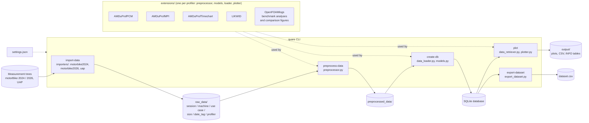

# Quare

**QUality AnalyzeR of application Efficiency**

> **Development status:** Quare is actively under development. The API,
> configuration format, and extension interface may change between releases.
> Contributions and feedback are welcome.

## Why Quare?

Modern HPC applications are hard to optimise. Profiling tools such as AMD uProf
generate large volumes of raw counter data, but turning that data into
actionable insight requires a repeatable, automated pipeline: ingest the raw
output, normalise it, store it in a structured form, and produce consistent
visualisations across runs, machines, and problem sizes.

Without such a pipeline, performance analysis becomes ad-hoc — scattered
spreadsheets, one-off scripts, and results that are difficult to reproduce or
compare. Quare solves this by providing a unified ETL and analytics framework
tailored to HPC workloads.

The name is deliberate. In Latin, *quare* means "therefore", "because of this",
"why" — which is exactly what the tool is designed to tell you: *why* does this
application perform the way it does on this hardware?

### Current scope

Quare currently focuses on **OpenFOAM**-based workloads as its primary
application target. OpenFOAM is a widely-used open-source CFD (Computational
Fluid Dynamics) framework, and the existing extensions, analyses, and example
configurations are oriented towards profiling OpenFOAM solvers at scale.
Support for other HPC application frameworks is planned for future releases.

Quare is a Python framework for ingesting, storing, and visualising
performance-profiling data from HPC applications.

The OpenFOAM analyses reproduce the analysis scripts of Łukasz Szustak for the
motorBike benchmark (2024 single-node and 2026 multi-node runs) and for the UAP
measurements (simpleFoam and pimpleFoam on seven AMD EPYC platforms). Their
results are taken from the database, and on the UAP data they equal the values
of the original scripts (see the changelog for the known differences).

## Supported profilers

| Extension | Profiler | Status |
|---|---|---|
| `AMDuProfPCM_ext` | AMD uProf Performance Counter Monitor | Stable |
| `AMDuProfMPI_ext` | AMD uProf MPI profiler | Stable |
| `OpenFOAMlogs_ext` | OpenFOAM `checkMesh`, `renumberMesh` and solver logs (cells, ranks, time steps, step times, per-step MPI profiling) and the benchmark analyses built on them | Work in progress |
| `AMDuProfTimechart_ext` | AMD uProf Timechart (node power traces) | Work in progress |
| `LIKWID_ext` | LIKWID `likwid-perfctr` statistics (L2, L3, NUMA groups: clock, data volume, bandwidth) | Work in progress |

## System overview



Every command reads the settings file. The extensions are discovered at run
time; each brings the preprocessing, the database tables, the loader and the
plotter (with its analyses) of one profiler. The database schema is in
[docs/source/db_diagram.png](docs/source/db_diagram.png).

## Prerequisites

- Python 3.10 or later
- [Poetry](https://python-poetry.org/) for dependency management
- `graphviz` system package (only needed for documentation generation)

## Installation

```bash
git clone https://github.com/HiPERACT-Data-analytics-and-AI/Quare.git
cd Quare
poetry install
```

The `quare` command is then available inside the Poetry environment:

```bash
poetry run quare --help
```

## Configuration

Quare is driven by a JSON settings file. Copy the bundled example and edit it
to match your data layout:

```bash
cp quare/settings.json my_settings.json
```

Key fields:

| Field | Description |
|---|---|
| `raw_data_directory_path` | Root of the raw profiler output tree |
| `preprocessed_data_directory_path` | Where preprocessed CSVs are written |
| `db_path` | Path to the SQLite database file |
| `output_directory_path` | Where plots and CSV exports are written |
| `task_sizes` | Map of task-size labels to numeric values |
| `session_name_contains` | Filter: keep only sessions whose name contains this string |
| `machine_name` | Filter: target machine name |
| `use_case_name` | Filter: target application/use-case name |
| `sizes_to_get` | List of task-size labels to include in plots |
| `repetition_name_contains` | Optional filter: keep only repetitions whose name contains this string (default: all) |
| `metric_names` | Specific metric names to plot (empty = all) |
| `analyses_names` | Specific derived analyses to plot (empty = all) |

The OpenFOAM analyses read further optional fields; see "Comparing machines"
below.

You can also point Quare at a settings file without editing the command line
every time by setting the environment variable:

```bash
export QUARE_SETTINGS=/absolute/path/to/my_settings.json
```

## Quickstart

Quare processes data in a few sequential steps.

### Step 0 — Import a measurement tree with a different layout (optional)

If your measurements are not yet in the layout described below, an importer
can convert them. The 2024 single-node (`--layout motorbike-2024`) and the
2026 multi-node OpenFOAM motorBike measurements with power
(`--layout motorbike-2026`) are supported, as are the UAP simpleFoam /
pimpleFoam measurements (`--layout uap`); `examples/motorbike_2024_import.json`,
`examples/motorbike_2026_import.json` and `examples/uap_import.json` show the
mapping files:

```bash
poetry run quare import-data --config my_settings.json --layout motorbike-2024 \
    --source /path/to/motorBike --map examples/motorbike_2024_import.json
```

The runs are written below `raw_data_directory_path`. The date directory of a
run may carry a tag after the timestamp (`20231228_174712_counters`); the
importer uses the tags `counters`, `trace`, `topdown`, `likwid` and (2026) `power` for the
kinds of measurement campaign; a tag may carry a label (`counters-1n2r` for
the UAP run `run_1n2r`). The settings `fvops_time_run` and `fvops_steps_run`
make FVOPS use the time of one labelled run and the step count of another, as
the UAP scripts do (`1n2r` and `1n4r`); without them FVOPS is the median of all
timing runs, which differs from the UAP value by up to 8% (mostly within 2%) on the
UAP data. The settings `median_of_even_runs` (`lower`, as the scripts, or `average`)
and `mpi_ratio_basis` (`last_step`, as the scripts, or `total_time`, which keeps the
MPI ratios below 100%) replace two other quirks of the scripts; the defaults
reproduce them. In the 2026 layout every run configuration
becomes a machine `<platform>_<nodes>N_<ranks per CCX>PCCX_<ranks>`, so that
the x axis is the number of cells per MPI rank.

### Step 1 — Preprocess raw profiler output

Splits and normalises the raw CSV files produced by the profiler into a
canonical layout under `preprocessed_data_directory_path`:

```bash
poetry run quare preprocess-data --config my_settings.json
```

### Step 2 — Load into the database

Reads the preprocessed CSVs and populates a SQLite database:

```bash
poetry run quare create-db --config my_settings.json
```

### Step 3 — Generate plots and exports

Queries the database and writes plots (PNG/SVG), CSV exports, and INFO tables
to `output_directory_path`:

```bash
poetry run quare plot --config my_settings.json
```

### Step 4 — Export the machine-learning dataset (OpenFOAM motorBike)

```bash
poetry run quare export-dataset --config my_settings.json --output dataset.csv
```

One row per run configuration (machine named `<platform>_<N>N_<C>PCCX_<R>`) and
mesh size of `sizes_to_get`, with the hardware, application, power, MPI volume
and AMD uProf counter features of the study. `--no-power` drops the power
columns, `--power-feature` selects other power features and `--style csv`
writes a plain CSV instead of the format of the original scripts.

## Comparing machines

With the setting `compare_machines` (a list of machine names) `quare plot`
also writes, to `<output>/<session>/<use case>/`, the figures and tables of the
analysis scripts. Each file is written only when its data exist:

| Output | Content |
|---|---|
| `Comparison.png` | per machine: FVOPS and the chosen ratios against cells per rank |
| `Timing comparison.png`, `Speedup.csv`, `Speedup.png` | solver times and speed-up between machines |
| `Solver timing comparison.png` | simpleFoam and pimpleFoam times of all runs (UAP) |
| `LIKWID L2/L3/Memory.png`, `Clock frequency [pimpleFoam].png` | LIKWID data volume, bandwidth and clock (UAP) |
| `PTI.png`, `PTI MPI volume.png` | per-thousand-instruction counters against FVOPS or MPI volume (setting `pti_sizes`) |
| `MPI time.csv`, `MPI calls.csv`, `MPI volume.csv` | MPI time per rank, share of selected MPI calls, total volume |
| `MPI profile <machine>.png` | MPI time step by step (machines with a profiling run) |

Optional settings: `machine_labels` (display names), `comparison_series`
(analyses on the right axis of `Comparison.png`), `predicted_fvops` (points of
a prediction model), `pti_sizes`, and the quirk switches described in Step 0.

## Expected data directory layout

Quare discovers profiling runs by walking a tree structured as:

```
raw_data/
└── <session>/                  e.g. Session1
    └── <machine>/              e.g. ROME_128 (a trailing _<n> gives the core count)
        └── <use_case>/         e.g. motorBike
            └── <task_size>/    e.g. small
                └── <date>/     e.g. 20260101_120000 (YYYYMMDD_HHMMSS[_<tag>])
                    └── <profiler>/   e.g. AMDuProfPCM
                        └── *.csv
```

## Adding a new profiler extension

Each profiler lives in a subdirectory of `quare/extensions/` whose name ends
with `_ext`. The directory must contain four modules that expose specific
module-level attributes:

| Module | Required attribute | Type |
|---|---|---|
| `preprocessor.py` | `__extension_data_preprocessor__` | `Preprocessor` subclass |
| `models.py` | ORM models | Subclasses of `MetricsDictBase` and `MetricsBase` |
| `loader.py` | `ExtensionDataLoader` implementation | `ExtensionDataLoader` subclass |
| `plotter.py` | `__extension_data_plotter__`, `__extension_data_retriever__`, `__extension_metrics_table__`, `__extension_metrics_dict__` | See `extension_abcs.py` |

Quare discovers extensions automatically at runtime — no registration step
is needed.

See the full API documentation and `AMDuProfPCM_ext` for a reference
implementation.

## Documentation

Build the full API reference locally (requires `graphviz` and the dev
dependencies):

```bash
bash generate_docs.sh
# open docs/build/html/index.html in a browser
```

## Development setup

```bash
poetry install          # install runtime + dev dependencies
sudo apt install graphviz -y   # for UML diagram generation
pre-commit install      # install git hooks (black, isort, flake8, …)
```

## License

MIT License — see [LICENSE](LICENSE).

Copyright (c) 2023-2026 Marcin Lawenda, Poznan Supercomputing and Networking Center
